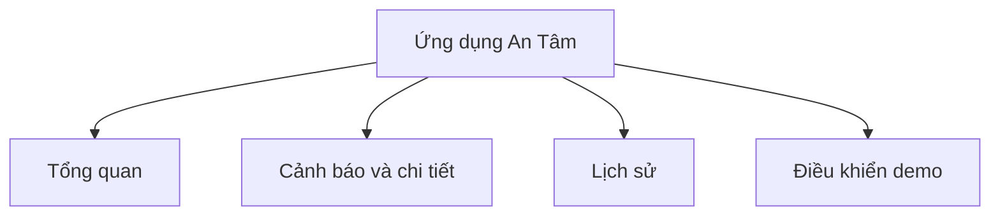
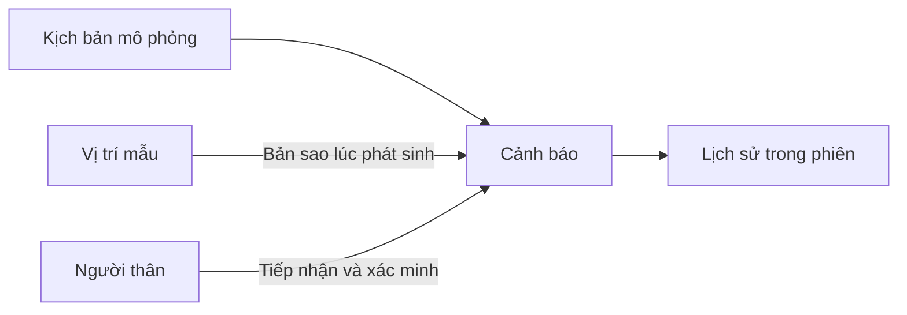
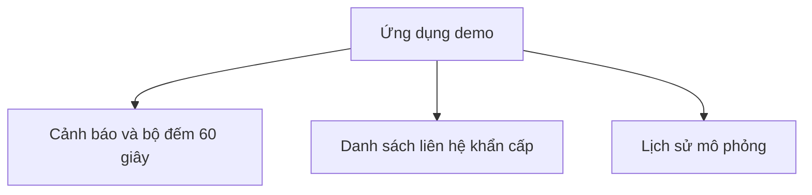
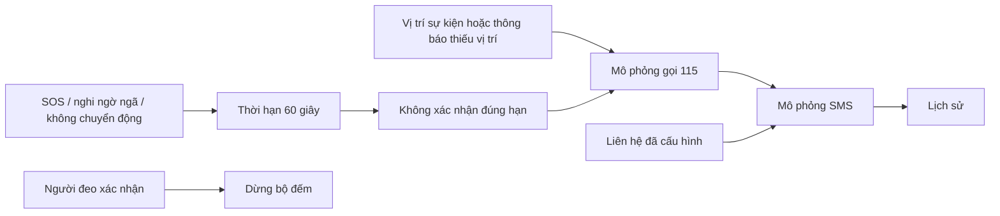

# An Tâm — ứng dụng mô phỏng chăm sóc người thân

Bản demo dành cho nhà đầu tư, dựa trên ý tưởng vòng tay hỗ trợ người cao tuổi. “An Tâm” là tên tạm. Bảng màu SOS dùng đỏ cho màu nhấn, nền trắng và xám trung tính; xanh lá cho trạng thái an toàn, hổ phách cho cảnh báo. Bố cục ban đầu tham khảo từ https://miraihealthcare.vn/. Không sử dụng logo, ảnh hoặc nội dung dịch vụ của Mirai Healthcare.

## Sử dụng

1. Chọn **Thử cảnh báo SOS** hoặc một tình huống trong **Điều khiển demo**.
2. Mở cảnh báo, chọn **Tôi tiếp nhận**.
3. Chọn **Liên hệ — mô phỏng** và kết quả liên hệ.
4. Nếu liên hệ được, chọn kết quả đã xác minh và lưu. Nếu chưa liên hệ được, sự kiện vẫn đang xử lý.
5. Xem **Lịch sử** hoặc **Đặt lại** để bắt đầu phiên mới.

Kịch bản bổ sung gồm nghi ngờ ngã, không ghi nhận chuyển động, mất kết nối và chưa có vị trí. Các kịch bản phát hiện chưa có ngưỡng hoặc thuật toán thực tế.

## GitHub Pages

Website: https://nhatdevzizi.github.io/Closer/

GitHub Pages phục vụ nội dung thư mục `dist` qua nhánh `gh-pages`. Trang này công khai, độc lập với bản riêng tư trên Sites.

Sau khi sửa và commit mã nguồn trên `main`, cập nhật Pages bằng:

```sh
git push origin main
git subtree split --prefix dist -b gh-pages
git push origin gh-pages
```

GitHub tự triển khai khi nhánh `gh-pages` được cập nhật. Push riêng nhánh `main` chưa cập nhật website. Tệp `.nojekyll` giữ cách phục vụ HTML, CSS và JavaScript tĩnh.

## Chạy trên máy

Ứng dụng là HTML, CSS và JavaScript chuẩn, không cần bước biên dịch hoặc thư viện chạy ứng dụng. Phục vụ thư mục `dist` bằng một máy chủ tĩnh, ví dụ `python -m http.server 4173 --directory dist`, rồi mở `http://localhost:4173`. Không mở trực tiếp tệp HTML bằng giao thức file vì ứng dụng dùng module JavaScript.

Chạy kiểm thử trạng thái bằng `node --test tests/state.test.js` với Node.js hiện đại. Font Be Vietnam Pro tải từ Google Fonts; khi không có mạng, giao diện dùng font dự phòng.

## Cấu trúc



## Quan hệ dữ liệu



Hai sơ đồ mô tả các thành phần đã triển khai và quan hệ dữ liệu, không biểu diễn số liệu đo lường.

## Kết quả kiểm tra

- Ba kiểm thử trạng thái đạt: luồng xử lý, bảo toàn vị trí sự kiện, mất kết nối, dữ liệu thiếu, đầu vào không hợp lệ, chống lặp và đặt lại.
- Kiểm thử tương tác bằng Edge đạt: SOS, chưa liên hệ được, ghi kết quả, ghi chú an toàn, nhiều cảnh báo, thay vị trí, thiếu vị trí, lịch sử, đặt lại và đóng hộp thoại trên điện thoại.
- Kiểm tra bề rộng 375, 768, 1024, 1440 và 1920 pixel: không cuộn ngang toàn trang. Không có lỗi JavaScript trong luồng kiểm thử.
- Đã xem ảnh máy tính và điện thoại; cảnh báo được đặt trước bản đồ trên điện thoại.
- Công cụ đo nhận nhầm các nhãn nằm trên bản đồ mô phỏng thành nhãn số đè lên biểu đồ. Các nhãn có nền trắng và là chú thích vị trí, không phải số liệu biểu đồ. Giữ cách hiển thị này sau khi xem ảnh.
- Giữ đường viền focus khi dùng bàn phím để người dùng biết vị trí đang thao tác.
- Có công cụ WebMCP khi trình duyệt hỗ trợ; đã kiểm tra hợp đồng đăng ký bằng môi trường giả lập. Chưa kiểm tra với trình duyệt hỗ trợ WebMCP gốc.

## Giới hạn

Mọi hồ sơ, vị trí, kết nối, cảnh báo và liên hệ đều được mô phỏng. Không có phần cứng, GPS, cuộc gọi, SMS hoặc thông báo thật. Dữ liệu chỉ tồn tại trong phiên; tải lại trang hoặc đặt lại sẽ xóa dữ liệu phiên.

Không có tài khoản ứng dụng, theo dõi người thật, doanh thu giả định, số liệu độ chính xác hoặc cam kết y tế. Quyền truy cập bản xuất bản do Sites quản lý; lần xuất bản đầu giữ riêng tư cho chủ sở hữu.

## Tự động xử lý sau 60 giây — mô phỏng

SOS, nghi ngờ ngã và không có chuyển động đều bắt đầu đếm ngược 60 giây. Mở chi tiết để xác nhận an toàn trên thiết bị mô phỏng. Gia đình chọn “Tôi tiếp nhận” không dừng bộ đếm. Nếu không xác nhận đúng hạn, demo ghi lại cuộc gọi 115 kèm vị trí sự kiện, sau đó ghi SMS cho từng liên hệ đã cấu hình. Không có vị trí hoặc không có liên hệ vẫn được ghi rõ trong lịch sử. Không có cuộc gọi, GPS hoặc SMS thật.

Thêm tối đa 10 liên hệ trong mục Liên hệ khẩn cấp, chọn Thêm liên hệ để mở hộp thoại, nhập tên và số điện thoại vào hai ô riêng rồi lưu. Chọn Sửa để cập nhật hoặc Xóa để gỡ một liên hệ. Danh sách chỉ lưu trong phiên. Mỗi cảnh báo chỉ tự động xử lý một lần. Trình duyệt dùng thời hạn tuyệt đối: nếu tab tạm dừng, việc mô phỏng được xử lý khi tab chạy lại; đóng hoặc tải lại trang sẽ mất phiên. Thiết bị thật cần bộ đếm nền và dịch vụ liên hệ đã được kiểm chứng.





Kiểm tra bổ sung: 6 kiểm thử trạng thái đạt, gồm mốc 60 giây, xác nhận người đeo, tiếp nhận của gia đình, chống lặp, thiếu vị trí, mất kết nối, kiểm tra liên hệ và bảo toàn dữ liệu đã ghi.

## Giao diện điện thoại

Thanh điều hướng, cảnh báo, danh sách liên hệ và hộp thoại có bố cục cho màn hẹp. Nút và ô nhập hỗ trợ thao tác chạm; chữ ô nhập tối thiểu 16px. Đã kiểm tra không tràn ngang ở 320, 375, 390, 768 và 1440px cho tổng quan, cảnh báo, lịch sử, hộp thoại liên hệ và SOS bằng khung trình duyệt cùng nguồn. Chưa kiểm tra bàn phím ảo trên điện thoại thật.
